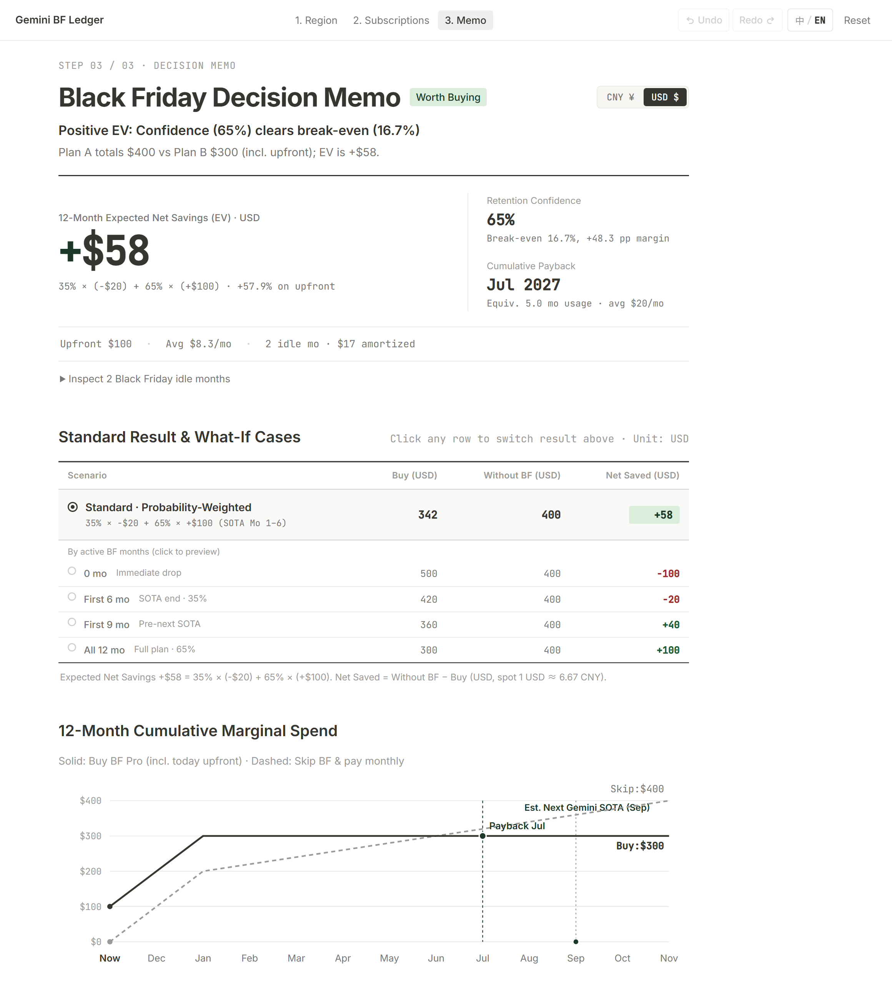

# Do You Really Need Gemini Pro Black Friday?

**Live Demo / 在线体验**：<https://l0dyv.github.io/Do-you-really-need-gemini-pro-bf/>

## 简介

计算订阅Gemini pro 黑五是否会亏损的工具,  避免不理智与冲动消费

通过对比你未来 12 个月 不买黑五 与 买黑五后 的真实订阅安排，结合你对当前模型 SOTA 周期与后续留存把握的判断，直接给出期望净节省（支持 CNY / USD 结算）、回本时间节点、不同实际使用月数下的盈亏对照与累积支出曲线

- 支持土 / 日 / 台 / 美 / 港五区黑五包年方案及自定义币种金额
- 不购买黑五和购买黑五优惠的对比
- 结合模型 SOTA 周期与留存概率给出加权期望值（EV）及分月对照切换
- 支持 3x 高清图 / SVG / HTML 等格式导出

## 友链

- [LINUX DO](https://linux.do/)

## Overview

A tool for calculating whether buying the Gemini Pro Black Friday deal will lose you money, helping you avoid irrational and impulse spending.

By comparing your real 12-month subscription plans without vs. with the Black Friday deal—together with your estimate of the current model's SOTA duration and post-SOTA retention confidence—it directly gives you expected net savings (in CNY / USD), payback timing, profit/loss comparisons across different active usage months, and a cumulative spend curve.

- Built-in Black Friday annual plans across 5 regions (TR / JP / TW / US / HK), plus custom currency and pricing
- Side-by-side comparison of your plans without vs. with the Black Friday deal
- Probability-weighted Expected Value (EV) based on model SOTA duration and retention confidence, with interactive scenario switching by active months
- Export as 3x HD PNG, SVG, standalone HTML, and more
